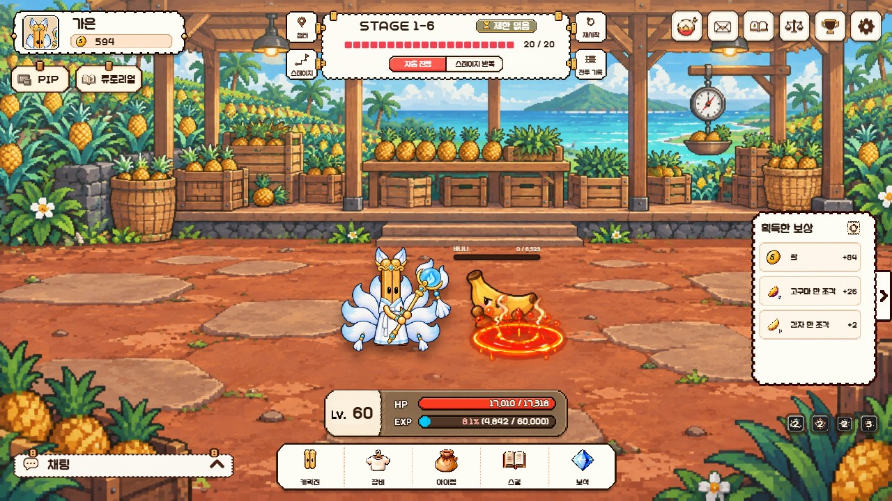
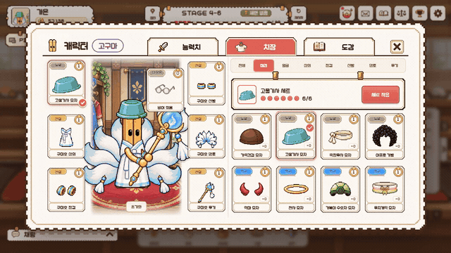

# 한짝

<p align="center"></p>



## 실제 동작 영상

치장 선택·착용 변경를 보여주는 실제 프로젝트 녹화입니다. (약 12초, 무음)

https://github.com/user-attachments/assets/86642eeb-62c6-48cf-91d5-1f8fefddea72

<details>
<summary>움직이는 GIF 미리보기</summary>

[](https://github.com/user-attachments/assets/86642eeb-62c6-48cf-91d5-1f8fefddea72)

</details>

[MP4 파일 다운로드](https://raw.githubusercontent.com/Seogaeun03/hanjjak/main/assets/demo.mp4)

캐릭터 성장·전투·치장 수집을 즐기는 웹 방치형 게임입니다. 팀이 GitLab에서 개발하고 배포한 프로젝트의 코드와 게임 자료를 공개용으로 정리했습니다.

## 주요 기능과 구성

- 계정·캐릭터와 스테이지 전투
- 치장 수집·도감·부위별 착용
- 거래소와 게임 재화 흐름
- 웹 클라이언트, 게임 API, 이벤트 처리와 공통 도메인 모듈

| 영역 | 기술 | 코드 |
|---|---|---|
| 웹 클라이언트 | React, TypeScript, Vite, Zustand | [apps/web/src](apps/web/src) |
| 게임 API | Kotlin, Spring Boot | [apps/game-api/src](apps/game-api/src) |
| 도메인 모듈 | Kotlin | [modules](modules) |
| 콘텐츠·계약 | TypeSpec, JSON, 공통 패키지 | [packages](packages) |
| 저장 구조 | PostgreSQL, Flyway | [DB 마이그레이션](apps/game-api/src/main/resources/db/migration) |

## 서가은의 역할

- 생성 AI를 활용한 치장 아트 제작에서 원본 캐릭터·색상·부위 겹침 순서를 기준으로 방향을 정하고 검수했습니다.
- 프레임별로 달라지는 장비 모양을 확인하고, 고정 마네킹과 여러 프레임을 함께 생성하는 제작 방식으로 전환했습니다.
- 게임 화면에 반영된 착용 모습과 레이어·크기·발끝 기준을 점검했습니다.
- UI와 플레이 QA, 발표 구성에 참여했습니다. 서버·거래 엔진·배포 인프라는 팀 기여로 구분합니다.

[치장 제작과 모션 검수 사례](docs/CASE_STUDY.md)

## 코드 둘러보기

`apps`에서 실행 단위를, `modules`에서 도메인별 서버 구현을 볼 수 있습니다. `packages`에는 계약·버전 콘텐츠 등 공통 자료가 있습니다. 팀 전체 구현을 보관한 저장소이므로 모든 코드를 개인이 작성했다는 의미는 아닙니다.

## 실행 준비

프론트 환경은 **Node.js 24 이상, pnpm 10.33.2**, JVM toolchain은 **21**입니다.

```sh
corepack enable
pnpm install --frozen-lockfile
pnpm --filter @hanjjak/web dev
```

서버는 PostgreSQL 등 필요한 로컬 서비스를 준비하고 `DB_URL`, `DB_USER`, `DB_PASSWORD` 등 환경변수를 설정한 뒤 실행합니다. 변수 이름과 기본 설정은 [게임 API 설정](apps/game-api/src/main/resources/application.yml)을 확인합니다.

```sh
./gradlew :apps:game-api:bootRun
```

Windows에서는 `gradlew.bat`을 사용합니다. OAuth·메일 등 외부 연동을 사용하려면 별도 키와 서비스 설정이 필요합니다.

검증 명령:

```sh
pnpm typecheck
pnpm test
./gradlew test
```

## 공개 범위와 리소스

내부 Notion 원문·서명된 첨부 링크, 운영 배포 파일과 테스트 계정 준비 자료는 공개본에서 제외했습니다. **별도 재배포가 금지된 긱블 말랑이체 파일은 포함하지 않습니다.** 실행 시 브라우저의 대체 폰트가 적용되거나, 해당 폰트를 적법하게 별도 준비해야 원래 화면을 재현할 수 있습니다.

주아체는 원래 포함된 OFL 고지를 유지했습니다. 자세한 조건은 [공개 범위](PUBLIC_SCOPE.md)와 [외부 자료 고지](THIRD_PARTY_NOTICES.md)에 있습니다. 원래 팀 GitLab 이력과 운영 서비스 상태는 이 공개 스냅샷과 별개입니다.
